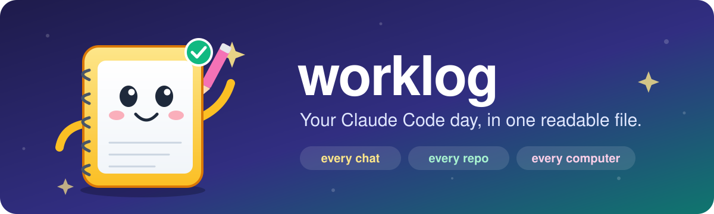
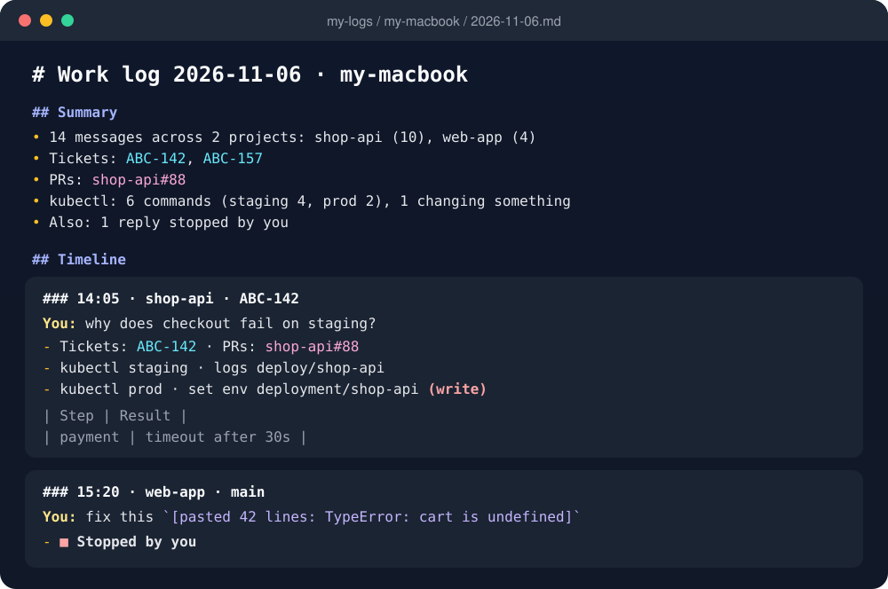
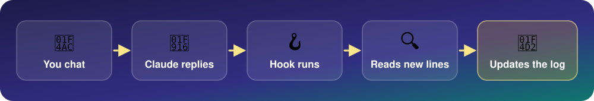

<p align="center">
  
</p>

<p align="center">
  
  
  
  
  
  
</p>

# 📒 Worklog

A Claude Code plugin that keeps **one readable log file per day** of everything you do with Claude
Code, across all your projects and computers. ✨

## 🔒 Disclaimer and privacy

> [!WARNING]
> **This plugin reads every Claude Code chat on your computer and writes parts of it to a folder you
> choose. Read this before installing.**

- 👀 **It reads all your Claude Code chats**, in every project: the transcript files Claude Code already
  keeps in `~/.claude/projects/`. It reads nothing else: no other files, browser data, keychain or
  other apps.
- ✍️ **It writes your messages in full** to the log folder, along with ticket numbers, PRs and summaries
  of the commands that ran, including commands run against production.
- 🧑‍💻 **It reads the code in your chats.** A chat's transcript holds everything Claude saw: the source
  files it opened, diffs, command output and anything you pasted. The plugin reads all of it to find
  what to log, but keeps very little of it:
  - **Kept:** code you type in a message (short snippets as typed; longer code blocks and pastes as
    one line, which still includes their **first line**), and **tables from Claude's replies**, which
    can hold query results, including rows of production data.
  - **Not kept:** files Claude read, diffs, command output, and code you had selected in your editor.

  So **your log can contain code and data from your projects.** Treat it with the same care as the
  repos themselves, and check your employer's rules before syncing it anywhere.
- 🏠 **Nothing leaves your computer.** There's no network access, no server, no analytics and no AI
  model. The only place data goes is the folder you pick, and from there wherever your sync app
  copies it.
- 🔑 **No special permissions.** The scripts run as you, with your normal file access, only while a hook
  runs. macOS may ask once whether your editor can access a protected folder such as Documents or
  iCloud Drive; that's the editor asking, not this plugin.
- 🧩 **Plugin hooks run with your full user permissions.** Installing any plugin means trusting its code.
  This one is about 900 lines of plain Python and shell with no dependencies, so you can read all of it
  first. `/hooks` in Claude Code shows what it registered.
- 🙈 **Secret masking is best effort.** Strings that look like API keys or tokens (`sk-ant-…`, `AKIA…`,
  `ghp_…`, Slack tokens, JWTs) are masked, but a password or secret in another format would be
  logged as typed. **Never pick a folder that other people can read.**
- 📌 **You're responsible for the logs.** Treat the log folder like your chat history: keep it private,
  and follow your employer's rules on where work information may be stored.

Provided as is, without warranty. Uninstalling stops all logging; your existing log files stay until
you delete them.

## 📝 What gets logged

- Your messages in full. Anything you paste becomes one line, such as
  `[pasted 186 lines: WORKER INVENTION ASSIGNMENT AGREEMENT]`.
- From Claude's replies, only:
  - tables (reports and query results)
  - Jira tickets
  - PRs
  - one line per kubectl command; commands that change something are marked **(write)**
  - any line that starts with `log:`, from you or from Claude
- **⏹ Stopped by you** on any reply you interrupted (Esc or the stop button).
- A summary of up to 5 points at the top of each day.

<p align="center">
  
  <br><sub>An example day file (made-up data)</sub>
</p>

Raw transcripts are never copied, and strings that look like API keys or tokens are masked.

## 💻 Supported systems

| System | Status | Folder picker in `/worklog:setup` |
|---|---|---|
| macOS | Tested | Finder dialog, with a Help button |
| Linux | Written, untested | `zenity` or `kdialog` in a desktop session; otherwise pass the path |
| Windows | Written, untested | Windows folder dialog (through PowerShell). Needs Git for Windows, which Claude Code uses to run hooks. |

It works wherever Claude Code runs on those systems: the VS Code, Cursor and JetBrains extensions, and
the terminal. It doesn't log Claude Code on the web (cloud sessions) or regular claude.ai chats.

**Requirements:** Python 3.8 or newer, standard library only. The launcher (`scripts/run.sh`) finds it
as `python3`, `python` or `py -3`. Without Python, nothing is logged and a message says what to
install. Nothing breaks in Claude Code.

## 🚀 Install

In Claude Code:

```
/plugin marketplace add sanchitarora802/Claude-worklogs
/plugin install worklog@worklog
```

Claude Code asks for the log folder when you install. You can leave it blank and run `/worklog:setup`
afterwards: it opens a folder picker, then a tick-box list of repos you don't want logged. Until a
folder is set, nothing is logged, and you'll see a reminder when a new chat starts.

After that, `/worklog:status` shows where logs are going, and `/worklog:day 2026-11-06` (or just asking
"what did I do last Friday?") summarises a day.

## 📁 Choosing a log folder

- **Pick a folder that syncs between your own computers**, such as one in iCloud Drive, Google Drive,
  Dropbox or OneDrive. Each computer writes only to its own subfolder
  (`<folder>/<computer name>/YYYY-MM-DD.md`), so syncing never conflicts, and you can see every
  computer's logs in one place.
- **Don't pick a folder shared with other people.** Logs hold your full messages, ticket numbers and the
  prod commands that ran.
- Avoid putting it inside a git repository, so logs don't get committed by accident.

If the folder goes missing, for example because a sync drive isn't mounted, logging pauses. It catches up
on its own once the folder is back.

## 🎛️ Options

Every option has a default, so at install only the folder needs an answer. Change any of them later.

| Option | Default | What it does | Change it with |
|---|---|---|---|
| 🔘 **Logging** | On | Off stops all logging. Chats while it's off are never logged, not even later. | `/config` toggle |
| 🚫 **Repos not to log** | None | Tick-box list of every folder you've used Claude Code in. A ticked folder covers its subfolders; new repos are logged unless you tick them. | `/worklog:repos` |
| 🗓️ **Keep logs for (days)** | 0 (forever) | Deletes this computer's day files older than that. Other computers' files are never touched. | `/config` |
| ⏪ **Backfill from** | Empty (everything) | Never logs anything older than this date (`YYYY-MM-DD`), including past chats logged at setup. | `/config` |

Changes apply from now on. To re-apply them to chats still on disk, run
`sh scripts/run.sh worklog.py --rebuild` from the plugin folder; day files older than Claude Code
keeps chats are left as they are.

## ⚙️ How it works

<p align="center">
  
</p>

## 🛡️ Safety

- **Missing folder** (a sync drive not mounted): logging pauses without creating a stand-in folder,
  and its place in each chat isn't moved, so it catches up once the folder is back.
- **No folder set:** nothing is logged and nothing is marked as read, so choosing a folder later
  still picks up every chat.
- **Missed replies:** stopping a reply with Esc skips that reply's hook, and a force-closed window
  skips the end-of-chat pass. The catch-up at the start of the next chat, in any repo, logs those
  lines. It runs in the background, so the new chat doesn't wait.
- **Two runs at once:** a file lock lets only one write at a time, so parallel chats in several editors
  don't clash.
- **Re-runs** never duplicate entries: each run reads only what's new since the last one, and a chat
  that has to be re-read from the start reuses its existing entries.
- **Uninstalling** removes the data folder. Your day files stay where they are.

## ⚠️ Limits

- Reports written as prose, not tables, aren't captured.
- Ticket and PR numbers are found by pattern, so an example in a reply (like `BUZZ-1234`) counts
  as a real one.
- A kubectl command run without `--context` shows as "current context", not the cluster's name.
- Claude Code deletes transcripts after 30 days by default (`cleanupPeriodDays`). Anything already
  logged stays logged, but you can't rebuild from chats older than that.
